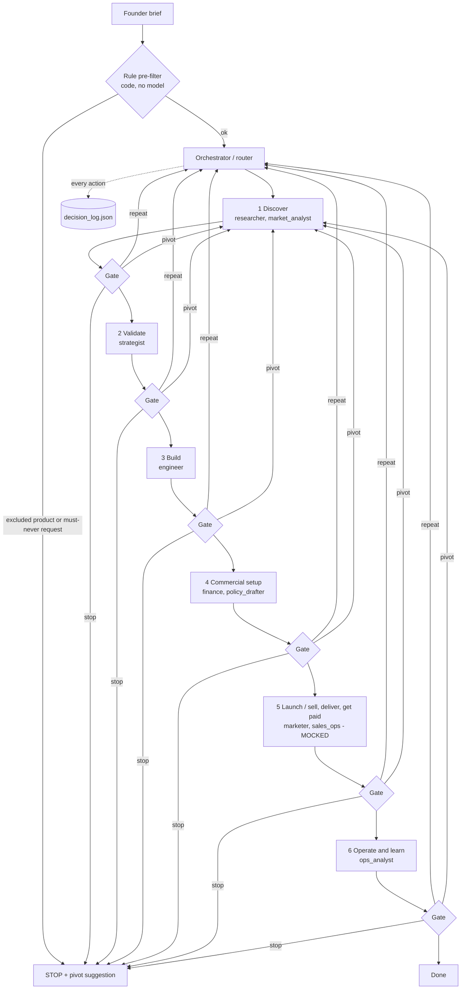
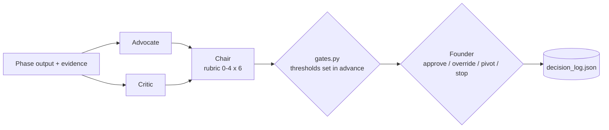
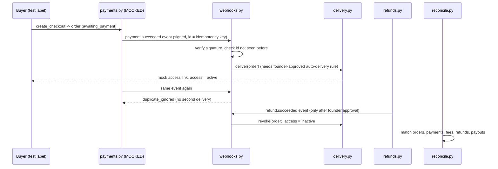
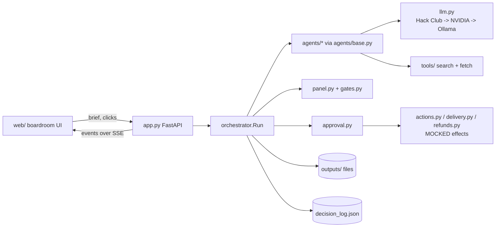

# Architecture

## Overview

VentureBoard is a team of AI agents that takes a founder's brief (idea, skills, budget, time, target market, values) toward a validated, sellable digital product in six phases. A router in code (`orchestrator.py`, the "chief of staff") decides which agent speaks next, gives each agent only the context it needs, and stops at a gate after every phase. At a gate, an Advocate and a Critic argue, a neutral Chair scores a fixed rubric, thresholds fixed in code can block a GO, and the founder decides. The system is built to recommend **stop** when the evidence is weak. Every outside effect is mocked and needs a signed founder approval, and every agent action is written to `decision_log.json`.

Design choices:

- **One voice at a time.** Agents never talk to each other directly. The router sequences them and the UI plays one spoken line at a time.
- **Narrow context.** Each agent gets the brief plus the few fields it needs, not the whole transcript.
- **Code decides what must be true.** Claim labels, forbidden content, gate thresholds and approvals are enforced in code. Prompts repeat the rules but are not relied on.
- **One file per role.** `agents/<role>.py` holds the output schema, `prompts/<role>.md` the prompt.

## Phases

Every agent returns JSON validated by a Pydantic model with `speech`, `emotion`, `claims` and role fields. After each call, code relabels claims (`SOURCED` only if the URL was retrieved in this run, otherwise `ASSUMPTION`), strips forbidden content, and logs the action.

### Phase 1: Discover (Core step: find opportunities)

- **Agents:** `orchestrator` (restates the brief, writes three search queries), `researcher`, `market_analyst`.
- **Tools:** `tools/search.py` (DuckDuckGo HTML, Wikipedia API, Hacker News API) and `tools/fetch.py` (page text, robots.txt respected, rate-limited). No key, no cost.
- **Method:** the queries build an evidence pack of results with URLs. The researcher sharpens the idea, names the first customer, and scores the starting idea against two alternatives (0-10). The market analyst defines the market and segments, lists existing alternatives and demand signals for and against, and writes a Mom Test interview plan with eight questions about past behaviour. The system cannot interview customers and does not simulate them; real notes come from the founder.
- **Output:** `phase1_step1_opportunities.md`, `phase1_step2_market.md`, `phase1_step3_mom_test_interviews.md`.
- **Gate:** at least 3 sourced market claims (`MIN_SOURCED_CLAIMS`), plus the panel.

### Phase 2: Validate (Core step: design the business)

- **Agent:** `strategist`.
- **Method:** fills a nine-block Lean Canvas, writes landing-page copy that code renders into a page (`templates.py`), and plans where to share it. The demand target (default 100 waitlist sign-ups in 14 days) is fixed in `gates.py` and shown before the test. Publishing the page needs founder approval and is MOCKED (a local file). The founder then reports the real sign-up count; the system never generates one.
- **Output:** `phase2_step1_lean_canvas.md`, `phase2_step2_landing_page_draft.html`, `phase2_step3_waitlist_plan.md`, `phase2_step4_landing_page_published_mocked.html`, `phase2_step5_demand_result.md`.
- **Gate:** reported sign-ups against the pre-set target.

### Phase 3: Build (Core step: build the product)

- **Agent:** `engineer`.
- **Method:** specifies a small content-type digital product (checklist, guide, template pack or planner) as modules of concrete items, with user docs. Code renders it to a single interactive HTML file and runs eight automated checks: name present, at least three modules, items per module, docs steps, well-formed HTML, every module rendered, no excluded-category content, no forbidden claims.
- **Output:** `phase3_step1_mvp.html`, `phase3_step2_user_docs.md`, `phase3_step3_test_report.md`.
- **Gate:** all MVP checks pass.

### Phase 4: Commercial setup (Core step: set the price and policies)

- **Agents:** `finance`, `policy_drafter`.
- **Method:** finance recommends one price and model, justified from competitor prices in the evidence or labelled assumptions, with break-even arithmetic against the founder's budget and no revenue forecast. The policy drafter writes plain-language terms, privacy and refund drafts; code labels each one "DRAFT, not legal advice; have a lawyer review." No payments of any kind are set up.
- **Output:** `phase4_step1_pricing.md`, `phase4_step2_policies_draft.md`.
- **Gate:** a price above zero and the DRAFT label on every policy.

### Phase 5: Launch, also called "Sell, deliver and get paid" (Core steps: open the store; deliver automatically)

The problem statement names this phase "Launch"; the repository conventions name it "Sell, deliver and get paid". Both are covered here.

- **Agents:** `marketer` (launch), `sales_ops` (sell, deliver, get paid).
- **Launch:** the marketer writes store-page copy and launch posts in the product's own voice. Code renders the store page with a MOCKED checkout button. Publishing the page and the posts are two separate pending actions; each needs founder approval and writes a local file only.
- **Sell, deliver, get paid (all MOCKED):** sales ops drafts the delivery message (sending it is a pending action, written to a local outbox). Then the sale-to-cash scenario runs in code: mock checkout, mock payment event, automatic delivery, duplicate webhook, tampered webhook, refund, payout and reconciliation. See "Sale to cash" below.
- **Output:** `phase5_step1_store_page_draft.html`, `phase5_step2_launch_posts_draft.md`, `phase5_step3_store_page_published_mocked.html`, `phase5_step4_launch_posts_published_mocked.md`, `phase5_step5_outbox_mocked.md`, `payment_test_log.md`.
- **Gate:** all sale-to-cash checks pass.

### Phase 6: Operate and learn

- **Agent:** `ops_analyst`.
- **Method:** writes support answers, the metrics to track for free, and a persevere-or-pivot memo based only on real evidence: sourced claims, the founder-reported demand result against its target, and real interview notes. Mocked sales are stated as mocked and never counted as results.
- **Output:** `phase6_step1_support_faq.md`, `phase6_step2_metrics.md`, `phase6_step3_persevere_or_pivot_memo.md`.
- **Gate:** the memo exists, plus the panel.

## Gates

The same gate code runs after every phase.

1. **Rule pre-filter** (`guardrails.py`, code only, before any model call): excluded product categories and must-never requests end the run with STOP and a pivot suggestion.
2. **Advocate and Critic** run in parallel, blind to each other, on different model families when hosted models are used. The Critic is told that finding reasons to stop is its job and must name the best pivot. Debate is capped at two rounds (`DEBATE_ROUNDS`).
3. **Chair** scores six criteria 0-4, read against the founder's brief: problem severity, market and demand, competition and differentiation, founder fit, feasibility as a digital product, fit with values and rules. Points backed only by assumptions score 0-1. The Chair gives one verdict and a warning about overriding it.
4. **Hard checks** (`gates.py`), fixed before the evidence exists and shown to the founder at the start: Phase 1 sourced claims, Phase 2 waitlist target, Phase 3 MVP checks, Phase 4 price and DRAFT labels, Phase 5 sale-to-cash checks, Phase 6 memo, and a Chair average of at least 2.5 for GO. Code can only make the outcome stricter (go < repeat < pivot < stop), never softer.
5. **Founder** approves the recommendation, overrides it, pivots or stops. An override is logged with the Chair's warning.

Outcomes: **go** (next phase), **repeat** (redo the phase once; a second failure becomes stop), **pivot** (restart at Phase 1 with the Critic's or the founder's pivot idea, once per run), **stop** (end; nothing is launched).

**When the system recommends STOP on weak evidence:**

- the brief is an excluded product or asks for a forbidden tactic (pre-filter);
- the Chair's rubric average is below 1.5 (below 2.0 recommends pivot);
- the demand test reaches under 25% of its pre-set target (under 50% recommends pivot, under 100% repeat). With the default target of 100, a founder reporting 12 sign-ups gets STOP, whatever the Chair said;
- a phase still fails its checks after one repeat, for example no sourced market claims after a second research attempt.

`PANEL_MODE=single` (automatic on the local model) makes one model call argue both sides and rule, to keep local runs fast. The hard checks and the founder step are identical in both modes.

## Sale to cash

All of this is MOCKED: there is no payment provider, real or sandbox, no money and no card data. The design is the one a real integration would need.

- **Payment triggers delivery:** `webhooks.handle_event` marks the order paid and calls `delivery.deliver`. Delivery is automatic per order, but the rule that enables it is approved once by the founder; without it, `deliver` raises.
- **Idempotency prevents double delivery:** every event id is stored after it is handled. Replaying an event returns `duplicate_ignored`. A tampered event fails the signature check.
- **A refund revokes access:** `refunds.refund` raises without a founder approval for that exact order. The mock refund event sets the order to refunded and switches access off.
- **Reconciliation:** `reconcile.reconcile` matches orders to payments, checks amounts, checks every refund has a refunded order with access off, and compares payouts with payments minus fees minus refunds. Mismatches are listed.
- Test runs are written to `outputs/payment_test_log.md`.

## Data flow

- **In:** the founder brief, founder notes, founder decisions, the founder-reported sign-up count, and public web pages.
- **Out:** files in the run's outputs folder, the decision log, and events for the UI. Nothing leaves the machine except model calls and web searches.
- **Decision log entry:** `timestamp`, `agent`, `action`, `sources`, `model`, `cost`, `approved_by`, plus `outcome` for gates and token counts for model calls.
- **Secrets:** an optional key is read from `.env` by `llm.py` only, sent only to the model provider, never logged, never sent to the browser.
- **Cost:** `llm.py` reads token usage from every response, prices it from the provider catalog, keeps a daily total and stops metered use at the budget cap. On HTTP 402 it falls back, on 429 it honours `Retry-After`, on 403 it stops and tells the founder.

## Built vs. stubbed

| Part | State |
|---|---|
| Rule pre-filter, output sanitizer, claim relabelling | Built |
| Six phases with one agent per department, panel, gates, founder decisions | Built |
| Approval layer with signed, content-bound approval records | Built |
| Boardroom UI with faces, expressions, voices, captions, claim badges, mute | Built |
| Decision log, cost tracking, budget cap, provider fallback | Built |
| Publishing landing page, store page and posts | MOCKED (local files) |
| Sending messages | MOCKED (local outbox file) |
| Waitlist form | MOCKED (collects nothing) |
| Checkout, payment events, delivery links, refunds, payouts, reconciliation | MOCKED (in-memory ledger) |
| Customer interviews | STUBBED (script only; no simulated answers) |
| Custom software MVPs (beyond content-type products) | STUBBED (not built) |
| LLM in the test suite | STUBBED (`tests/stub_llm.py`, tests only) |

## Roadmap

1. **Evidence:** more free sources, a second fact-check pass on sourced claims, and a form for founders to log real interview notes per person.
2. **Build:** code-generating MVPs run in a sandbox with real unit tests.
3. **Real adapters, opt-in:** publishing and payment adapters behind the same approval layer, off by default, with the mocks kept for tests.
4. **Gates:** per-domain rubrics, and a second LLM-based check alongside the pattern rules in the pre-filter.
5. **Boardroom:** local open-source text-to-speech, multi-language voices, and a replay view of past runs.
6. **Community:** a contribution guide, a public eval set of trick prompts, and saved runs that can be shared as text.
